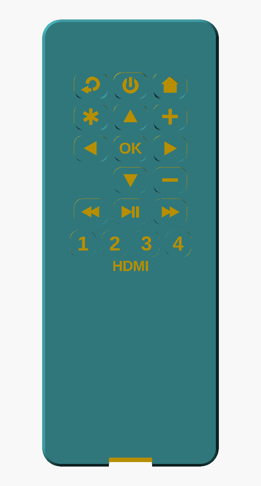
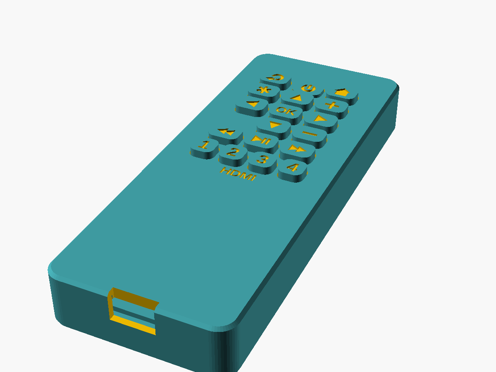
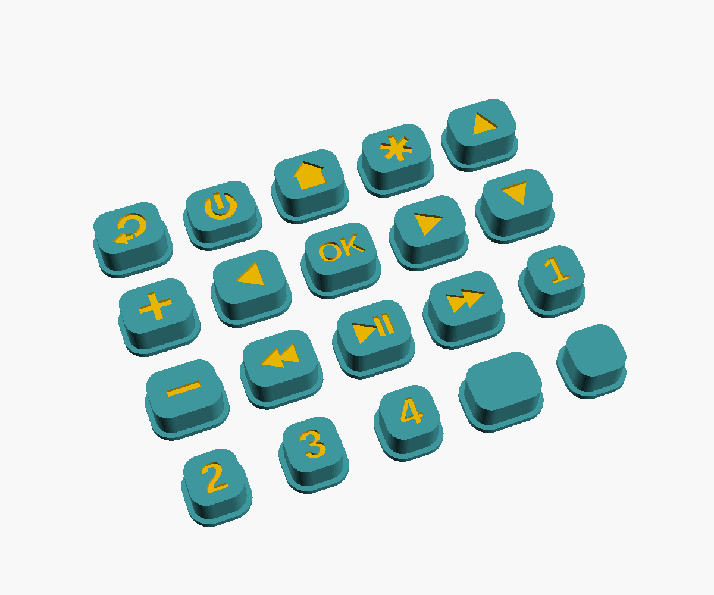
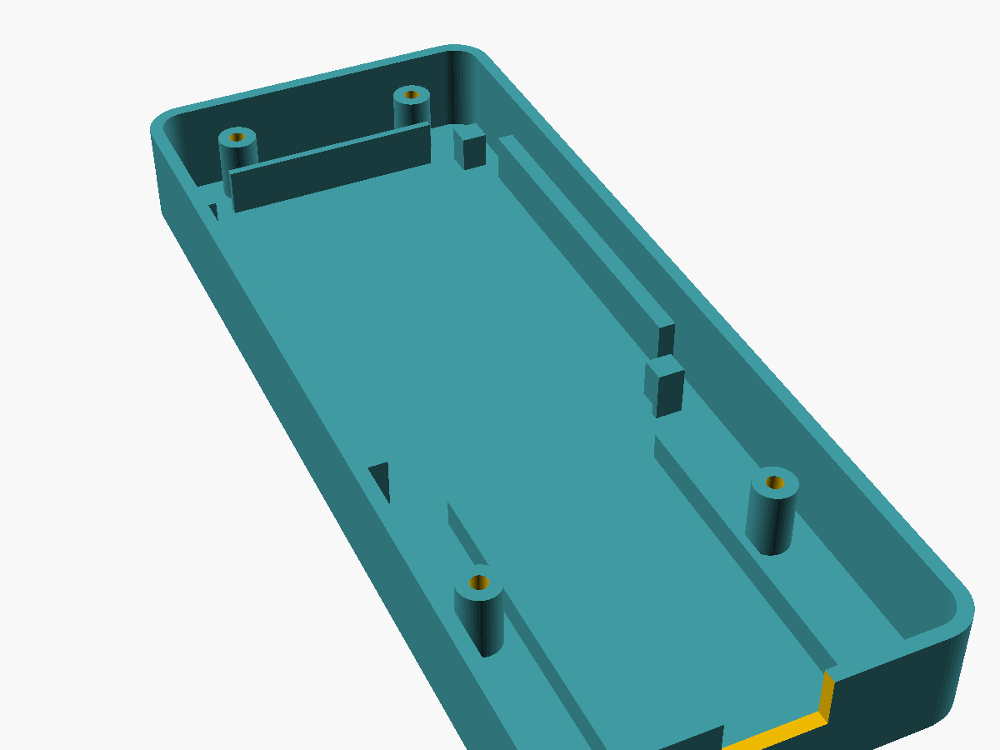

# Building the handheld remote

A USB-powered handheld remote: 18 buttons on one perfboard, an ESP32 in the bottom of the case, and a 3D-printed two-piece shell with printed, labeled button caps. The case is about **57 × 144 × 18 mm**, roughly the size of a TV remote.

  
  

| Caps (printed with engraved labels) | Inside the bottom shell |
|---|---|
|  |  |

The STL files in `stl/` were exported from `roku_remote_case.scad` with OpenSCAD 2021.01 and checked for collisions between every pair of parts. To change anything (switch height, cap size, clearances, layout), edit the parameters or the `BUTTONS` table at the top of the `.scad` file. Then re-export each part with `openscad -D 'PART="lid"' -o stl/lid.stl roku_remote_case.scad`, using `bottom`, `lid`, `caps` or `coupon` as the part name.

## Parts

| Part | Qty | Approx. cost | Link |
|---|---|---|---|
| 6×6 mm tactile switch, 4-pin through-hole, **7 mm height (6x6x7)** | 18 (+spares) | $1–3 per 100 | [AliExpress](https://www.aliexpress.us/item/3256808112405709.html). Pick the **6x6x7mm** option |
| Perfboard, **5 × 7 cm**, 2.54 mm pitch, 18 × 24 holes | 1 | $2–4 per pack | [AliExpress](https://www.aliexpress.us/item/2251801703672261.html). Pick the 5×7 cm option |
| ESP32-WROOM-32 dev board, 38-pin, USB-C, CP2102 | 1 | $3–5 | [AliExpress](https://www.aliexpress.com/item/1005004697683601.html). Pick **Type-C** |
| M2 × 10 mm self-tapping pan-head screws | 4 | $2 for a kit | [AliExpress search](https://www.aliexpress.us/w/wholesale-m2-self-tapping-screw.html) |
| 28–30 AWG hook-up wire (silicone is easiest) | ~3 m | $2–3 | [AliExpress search](https://www.aliexpress.us/w/wholesale-30awg-silicone-wire.html) |
| USB-C cable (2–3 m) and a USB phone charger | 1 | you probably have these | — |

Costs are rough and from memory, so check the listing before ordering. The model is built around these exact dimensions. If your switches are a different height, or your ESP32 is a different size, change `sw_h`, `esp_len` or `esp_w` at the top of `roku_remote_case.scad` and re-export.

## Printing

| File | What it is | Orientation |
|---|---|---|
| `stl/bottom.stl` | Bottom shell | As exported (floor on the bed) |
| `stl/lid.stl` | Faceplate | As exported (face on the bed) |
| `stl/caps.stl` | 18 caps + 2 blank spares | As exported (flange on the bed) |
| `stl/coupon.stl` | Optional fit test | As exported |

- **Settings:** PLA, 0.2 mm layers (0.12–0.16 mm for the caps if they'll do it), 3 walls, 15–20% infill, **no supports needed**.
- **Labels:** the button labels are engraved 0.6 mm deep. On a single-color print, rub acrylic paint or a paint pen into them and wipe the surface clean.
- **Fit test:** if you want to check tolerances first, print `coupon.stl` alone. The caps should slide through the holes with a little play, and an M2 screw should thread into the post. If anything is tight, raise `hole_clear` (or lower `scr_pilot`) in the `.scad` and re-export.

## Perfboard layout

Hold the board button-side up, long edge vertical. The **top** is the end farthest from the ESP32. Count holes from the top-left: **columns 1–18** left to right, **rows 1–24** top to bottom.

Each switch spans 3 columns and 4 rows. Its legs go in the columns and rows listed below, with the legs coming out of the top and bottom faces of the switch. The legs are spaced 6.5 × 4.5 mm and the holes 7.62 × 5.08 mm, so squeeze the legs slightly and they'll snap in.

| Button | GPIO | Leg columns | Leg rows |
|---|---|---|---|
| Back | 25 | 4 & 6 | 1 & 4 |
| Power | 2 | 9 & 11 | 1 & 4 |
| Home | 26 | 14 & 16 | 1 & 4 |
| Info (*) | 19 | 4 & 6 | 5 & 8 |
| Up | 23 | 9 & 11 | 5 & 8 |
| Vol + | 14 | 14 & 16 | 5 & 8 |
| Left | 4 | 4 & 6 | 9 & 12 |
| OK | 15 | 9 & 11 | 9 & 12 |
| Right | 5 | 14 & 16 | 9 & 12 |
| Down | 21 | 9 & 11 | 13 & 16 |
| Vol − | 12 | 14 & 16 | 13 & 16 |
| Rev | 33 | 4 & 6 | 17 & 20 |
| Play/Pause | 32 | 9 & 11 | 17 & 20 |
| Fwd | 27 | 14 & 16 | 17 & 20 |
| HDMI 1 | 13 | 3 & 5 | 21 & 24 |
| HDMI 2 | 16 | 7 & 9 | 21 & 24 |
| HDMI 3 | 17 | 11 & 13 | 21 & 24 |
| HDMI 4 | 18 | 15 & 17 | 21 & 24 |

The slot at columns 4–6, rows 13–16 (left of Down) is intentionally empty. You can add a button there later, e.g. Mute.

Keep the four corners of the board clear (about 4 mm in from each corner). The case's support posts press there.

## Wiring

On the back of the board, for every switch:

1. **Diagonal legs only.** Use the top-left leg and the bottom-right leg. Diagonal legs are always on opposite sides of the switch contact. The other two pairs are connected to each other inside the switch, so wiring those would do nothing. A multimeter in continuity mode will confirm it: no beep at rest, beep when pressed.
2. **Ground:** join every switch's bottom-right leg into one ground bus. A bare wire run along each row, tied together down column 18 (which is empty), works well. Run one wire from the bus to a **GND** pin on the ESP32.
3. **Signals:** solder one wire from each switch's top-left leg to the GPIO in the table above. About 15 cm per wire is plenty. Bundle the wires under the board; there's about 5 mm of space down there.

The GPIO numbers are the ones `roku_remote.ino` already uses, so no code changes are needed.

## The ESP32

The ESP32 sits in the bottom bay, **components up, with its header pins standing on the floor** between the two rails, and the **USB-C end against the end wall** so the plug can go through the slot.

Solder each wire to the short pin stub on the **top** (component side) of the board, right next to its pin label. That's easier than reaching the long pins underneath. A dab of hot glue at each end of the pin rows keeps the board from shifting.

## Assembly

1. Flash the ESP32 first (see the main README), then wire it to the perfboard.
2. Drop the perfboard onto its four corner posts. The ribs on the right side and top locate it.
3. Put each cap onto its switch stem, flange down. Every cap has its own label, and the layout is in the `BUTTONS` table in the `.scad` file.
4. Lower the faceplate over the caps, keeping it level so they all go through their holes. Then turn the case over and drive the four M2 × 10 screws in from the bottom.
5. Plug in the USB-C cable through the slot.
